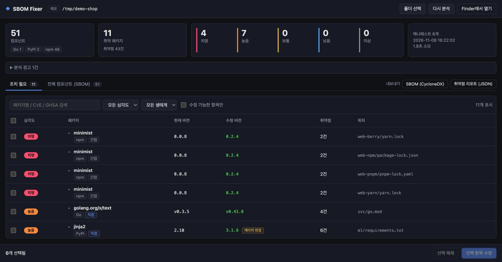
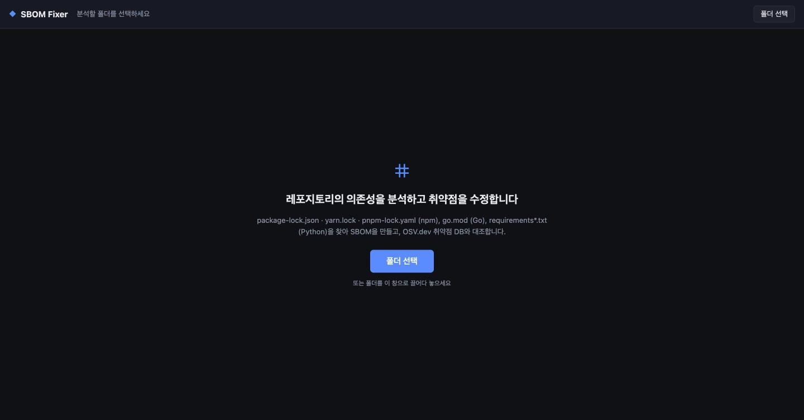
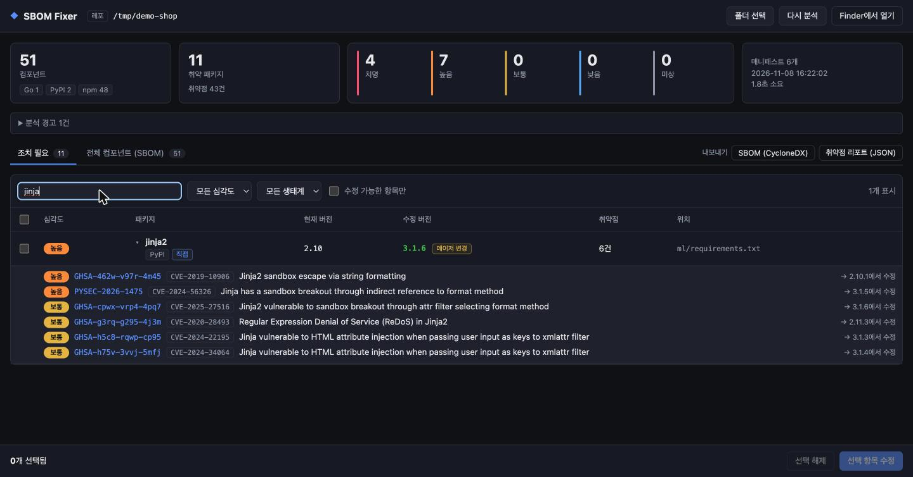
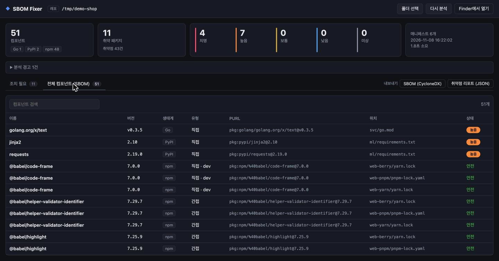
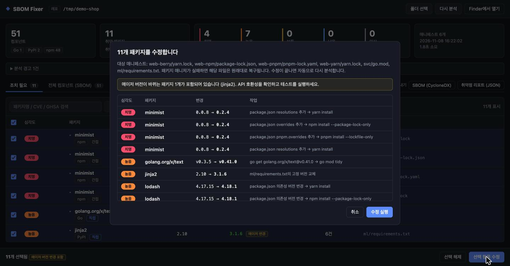
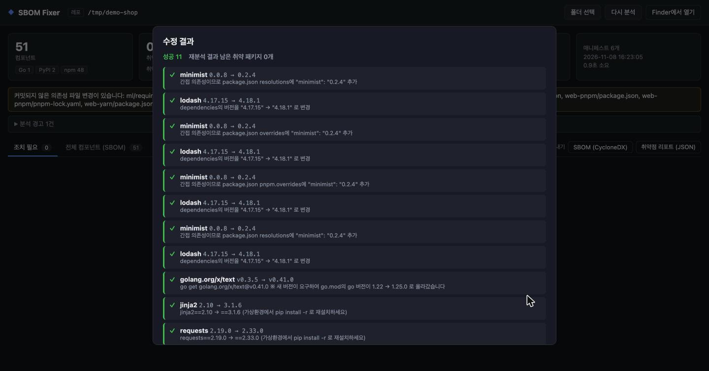
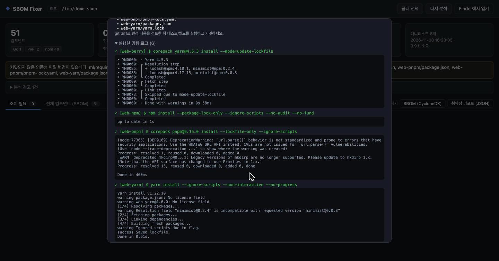
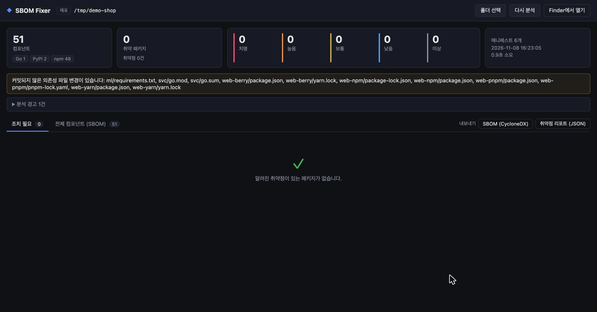
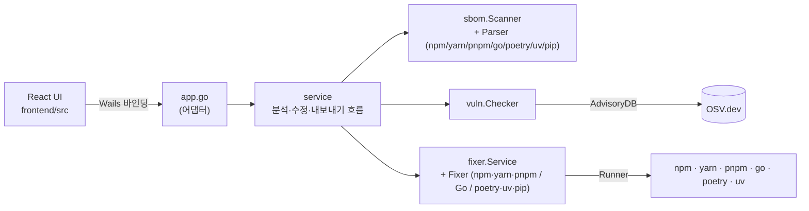

# SBOM Fixer

[](https://github.com/dbsgur/sbom-fixer/actions/workflows/ci.yml)

레포지토리 폴더를 고르면 **SBOM(소프트웨어 구성 목록)을 만들고, 알려진 취약점이 있는 패키지를 찾아, 선택한 패키지를 안전한 버전으로 자동 수정**하는 데스크톱 앱입니다.
npm · yarn · pnpm · Go · Python 프로젝트를 한 번에 다루고, 수정은 각 패키지 매니저의 방식 그대로 적용합니다. [Wails v2](https://wails.io)(Go + React/TypeScript)로 만들었습니다.



<details>
<summary><b>목차</b></summary>

- [한눈에 보기](#한눈에-보기)
- [빠른 시작](#빠른-시작)
- [사용 방법](#사용-방법)
  - [1. 레포 선택](#1-레포-선택)
  - [2. 분석 결과 읽기](#2-분석-결과-읽기)
  - [3. 취약점 상세와 검색](#3-취약점-상세와-검색)
  - [4. 전체 컴포넌트 (SBOM)](#4-전체-컴포넌트-sbom)
  - [5. 선택한 패키지 수정](#5-선택한-패키지-수정)
  - [6. 수정 결과 확인](#6-수정-결과-확인)
  - [7. 내보내기 (CycloneDX / 취약점 리포트)](#7-내보내기-cyclonedx--취약점-리포트)
- [지원 범위](#지원-범위)
- [수정 버전은 어떻게 정하나요?](#수정-버전은-어떻게-정하나요)
- [제한 사항](#제한-사항)
- [아키텍처](#아키텍처)
- [개발](#개발)

</details>

## 한눈에 보기

```
폴더 선택 ─▶ 의존성 파일 탐색 ─▶ SBOM 생성 ─▶ OSV.dev 취약점 조회 ─▶ 조치 목록 ─▶ 선택 후 수정 ─▶ 자동 재분석
```

| | |
|---|---|
| **분석 대상** | `package-lock.json` · `yarn.lock` · `pnpm-lock.yaml` · `go.mod` · `poetry.lock` · `uv.lock` · `requirements*.txt` (하위 폴더까지, 모노레포 OK) |
| **취약점 DB** | [OSV.dev](https://osv.dev) (GitHub Advisory, Go Vulnerability DB, PyPA 등 통합) — API 키 불필요 |
| **수정 방식** | npm/yarn/pnpm: `package.json` 수정 + lock 갱신 · Go: `go get` + `go mod tidy` · poetry/uv: `poetry add`·`uv add` 등 + lock 갱신 · requirements: 고정 버전 교체 |
| **안전장치** | 수정 전 확인 다이얼로그, 실패 시 자동 원복, 수정 후 lock 재검증, 자동 재분석 |
| **내보내기** | CycloneDX 1.5 SBOM, 취약점 리포트 JSON |

## 빠른 시작

```bash
git clone https://github.com/dbsgur/sbom-fixer.git && cd sbom-fixer
nvm use                      # Node 24 (.nvmrc)
make build                   # → build/bin/sbomapp.app
open build/bin/sbomapp.app
```

필요한 것: Go 1.22+, Node 24 LTS, [Wails CLI](https://wails.io) (`go install github.com/wailsapp/wails/v2/cmd/wails@latest`).
[CI 실행 결과](https://github.com/dbsgur/sbom-fixer/actions/workflows/ci.yml)의 Artifacts에서 빌드된 macOS 앱(`sbomapp-macos`, 7일 보관)을 받을 수도 있습니다.

> 앱 실행 자체에는 Node가 필요 없습니다. 다만 **수정** 기능은 대상 프로젝트의 패키지 매니저(npm, go 등)를 실행하므로 그 도구가 설치되어 있어야 합니다. yarn/pnpm은 없어도 Node에 포함된 corepack으로 실행합니다.

## 사용 방법

아래 화면은 npm·yarn classic·yarn berry·pnpm·Go·Python(requirements) 프로젝트가 섞인 데모 레포(`/tmp/demo-shop`)를 실제로 분석·수정한 결과입니다. 데모 레포는 [`internal/service/testdata/vulnerable`](internal/service/testdata/vulnerable)에 있습니다(이후 poetry·uv 프로젝트가 추가되어 지금은 화면보다 패키지가 많습니다).

### 1. 레포 선택



세 가지 방법 중 하나로 분석할 폴더를 지정합니다.

- **폴더 선택** 버튼으로 고르기
- 폴더를 창으로 **드래그 앤 드롭** (파일을 놓으면 그 파일이 있는 폴더를 분석)
- 터미널에서 인자로 넘기기: `build/bin/sbomapp.app/Contents/MacOS/sbomapp ~/work/my-project`

폴더를 지정하면 바로 분석이 시작됩니다. `node_modules`, `vendor`, `venv`와 숨김 폴더(`.git` 등)는 건너뜁니다.

### 2. 분석 결과 읽기


**요약 카드**

| 카드 | 의미 |
|---|---|
| 컴포넌트 | SBOM에 포함된 패키지 수와 생태계별 개수 |
| 취약 패키지 | 알려진 취약점이 하나라도 있는 패키지 수 / 취약점 총 건수 |
| 치명·높음·보통·낮음·미상 | 패키지별 **가장 높은 심각도** 기준 개수. GitHub Advisory 등급을 우선 쓰고, 없으면 CVSS v3 벡터로 계산 |
| 매니페스트 | 분석한 lock/매니페스트 파일 수, 분석 시각, 소요 시간 |

**경고 배너**
- *Git 저장소가 아닙니다*: 수정 후 되돌리기 어려우니 백업을 권장
- *커밋되지 않은 의존성 파일 변경이 있습니다*: 수정 전후 차이를 `git diff`로 구분하기 어려울 수 있음
- *분석 경고*: 예) lock 파일 없는 `package.json`·`pyproject.toml`, `==`로 고정되지 않은 requirements 패키지(버전을 몰라 제외)

**조치 필요 표**

| 열 | 설명 |
|---|---|
| 심각도 | 해당 패키지 취약점 중 가장 높은 등급 |
| 패키지 | 이름 + 생태계 + **직접**(내 package.json/go.mod에 선언) / **간접**(다른 패키지를 통해 들어옴) |
| 수정 버전 | 알려진 취약점을 모두 해결하는 최소 버전. 배지: `메이저 변경`(호환성 확인 필요), `일부만 해결`(수정 버전이 없는 취약점 존재), `미해결 잔존`(권장 버전에도 미해결 취약점) |
| 위치 | 패키지가 발견된 lock/매니페스트 파일. 같은 패키지라도 프로젝트마다 따로 표시·수정 |

### 3. 취약점 상세와 검색



- 행을 클릭하면 취약점 목록이 펼쳐집니다. 각 항목에 **ID(GHSA/PYSEC/GO)·CVE·요약·이 취약점을 해결하는 버전**이 나오고, ID를 누르면 OSV 상세 페이지가 열립니다.
- 위 예시에서 jinja2의 수정 버전이 `3.1.6`인 이유: 6개 취약점이 각각 `2.10.1`, `3.1.5`, `3.1.6`, `2.11.3`, `3.1.3`, `3.1.4`에서 해결되므로 **전부를 해결하는 가장 낮은 버전**이 3.1.6입니다. 2.x → 3.x라서 `메이저 변경` 배지가 붙었습니다.
- 검색창은 패키지명뿐 아니라 **CVE/GHSA ID**로도 찾습니다 (예: `CVE-2021-44906`).
- 심각도·생태계 필터, "수정 가능한 항목만" 체크박스로 목록을 좁힐 수 있습니다.

### 4. 전체 컴포넌트 (SBOM)



취약 여부와 상관없이 발견된 모든 패키지를 보여 줍니다. 패키지마다 버전, 생태계, 직접/간접·dev 여부, [PURL](https://github.com/package-url/purl-spec), 발견 위치, 상태(안전/심각도)가 나옵니다.

### 5. 선택한 패키지 수정



체크박스로 패키지를 고르고(헤더 체크박스 = 수정 가능한 항목 전체) **선택 항목 수정**을 누르면 확인 다이얼로그가 뜹니다. 패키지마다 **실제로 무엇을 할지**가 표시되고, 메이저 버전 변경이 포함되면 경고가 나옵니다.

| 대상 | 직접 의존성 | 간접 의존성 | lock 갱신 명령 |
|---|---|---|---|
| npm | `package.json` 버전 상향 (`^`·`~`·고정 형식 유지) | `overrides` 추가 | `npm install --package-lock-only --ignore-scripts` |
| yarn berry (v2+) | 〃 | `resolutions` 추가 | `yarn install --mode=update-lockfile` |
| yarn classic (v1) | 〃 | `resolutions` 추가 | `yarn install --ignore-scripts` |
| pnpm | 〃 | `pnpm.overrides` 추가 | `pnpm install --lockfile-only --ignore-scripts` |
| Go | `go get 모듈@버전` | 〃 | `go mod tidy` |
| poetry | `poetry add 이름<제약> --lock` (그룹 유지: `--group dev`) | `poetry update 이름 --lock` (상위 패키지 제약 범위 내) | `--lock`이 lock만 갱신 |
| uv | `uv add 이름<제약> --no-sync` (`--group`·`--optional` 유지) | `uv lock --upgrade-package 이름==버전` | `--no-sync`로 설치 없이 lock만 갱신 |
| requirements | `requirements*.txt`의 `==버전` 교체 (extras·마커·주석 유지) | – | – (가상환경에서 `pip install -r`로 재설치 필요) |

- 설치 스크립트는 실행하지 않습니다(`--ignore-scripts`).
- **poetry/uv**는 기존 선언의 제약 형식(`==`·`~=`·`^`·`~`, 그 외는 `>=`)과 extras(`[socks]`)·환경 마커를 유지합니다. 직접 의존성을 먼저 올린 뒤 간접 의존성을 처리해서, 상위 패키지(requests) 업그레이드로 풀린 하위 패키지(urllib3)까지 한 번에 올라갑니다. 상위 제약 때문에 못 올리면 강제하지 않고 원인을 알려 줍니다.
- `package.json`의 `packageManager`(예: `"pnpm@9.15.0"`)에 버전이 고정돼 있으면 corepack으로 **그 버전을 그대로** 실행합니다. yarn berry lock에는 전역 yarn classic을 쓰지 않고, pnpm은 lockfile 버전에 맞는 메이저(5.x→7, 6.x→8, 9.x→9)를 써서 lock 형식이 바뀌지 않게 합니다.

### 6. 수정 결과 확인



패키지별 성공/실패와 실제로 한 일이 표시되고, 끝나면 **자동으로 다시 분석**해 남은 취약 패키지 수를 알려 줍니다. 데모에서는 11개 모두 성공, 재분석 결과 0개였습니다.

- 패키지 매니저 명령이 실패하면 그 프로젝트의 `package.json`·lock(또는 `go.mod`·`go.sum`)을 **수정 전 상태로 복구**합니다.
- 명령이 성공해도 lock 파일을 다시 읽어 **목표 버전이 실제로 반영됐는지 검증**합니다. 이전 버전이 남아 있으면 실패로 표시합니다.
- 새 버전 때문에 `go.mod`의 `go` 지시어가 올라가면 따로 알려 줍니다.



**변경된 파일** 목록과 **실행한 명령 로그**(출력 포함)를 펼쳐 볼 수 있습니다.



수정 후에는 변경된 의존성 파일이 배너로 표시됩니다. 데모 레포에서 실제로 생긴 변경은 다음과 같습니다.

<details>
<summary><code>git diff</code> 보기</summary>

```diff
--- a/web-npm/package.json
+++ b/web-npm/package.json
   "dependencies": {
-    "lodash": "4.17.15",
+    "lodash": "4.18.1",
     "mkdirp": "0.5.1"
+  },
+  "overrides": {
+    "minimist": "0.2.4"
   }

--- a/web-yarn/package.json
+++ b/web-yarn/package.json
   "devDependencies": {
     "@babel/code-frame": "7.0.0"
+  },
+  "resolutions": {
+    "minimist": "0.2.4"
   }

--- a/web-pnpm/package.json
+++ b/web-pnpm/package.json
-  "packageManager": "pnpm@9.15.0"
+  "packageManager": "pnpm@9.15.0",
+  "pnpm": {
+    "overrides": {
+      "minimist": "0.2.4"
+    }
+  }

--- a/svc/go.mod
+++ b/svc/go.mod
-go 1.22
+go 1.25.0
-require golang.org/x/text v0.3.5
+require golang.org/x/text v0.41.0

--- a/ml/requirements.txt
+++ b/ml/requirements.txt
-requests==2.19.0
+requests==2.33.0
 flask>=2.0  # unpinned
-Jinja2==2.10 ; python_version>"3"
+Jinja2==3.1.6 ; python_version>"3"
```

`package.json`은 키 순서와 들여쓰기를 그대로 유지합니다. 위 diff에서 lodash 버전 변경이 있는 yarn/pnpm 쪽 줄과 lock 파일 변경(전체 11개 파일, +68/-47)은 생략했습니다.
</details>

수정 후에는 `git diff`로 검토하고, 테스트·빌드를 실행한 뒤 커밋하세요.

### 7. 내보내기 (CycloneDX / 취약점 리포트)

결과 탭 오른쪽의 **내보내기** 버튼으로 마지막 분석 결과를 파일로 저장합니다.

| 버튼 | 파일 | 내용 |
|---|---|---|
| SBOM (CycloneDX) | `<프로젝트>.cdx.json` | [CycloneDX 1.5](https://cyclonedx.org/docs/1.5/json/) JSON. 모든 컴포넌트(PURL, 발견 위치) + `vulnerabilities`(등급, 영향 컴포넌트, 권장 버전) |
| 취약점 리포트 (JSON) | `<프로젝트>.vulns.json` | 요약(심각도·생태계별 개수, 수정 가능 패키지 수) + 패키지별 권장 버전과 취약점 목록 |

<details>
<summary>취약점 리포트 예시 (데모 레포, <code>findings</code>는 1건만 발췌)</summary>

```json
{
  "schemaVersion": "1",
  "tool": "sbom-fixer",
  "generatedAt": "2026-11-08T16:24:02+09:00",
  "scannedAt": "2026-11-08 16:24:02",
  "project": {
    "name": "demo-shop",
    "path": "/path/to/demo-shop",
    "manifests": ["ml/requirements.txt", "svc/go.mod", "web/package-lock.json", "web-berry/yarn.lock", "web-pnpm/pnpm-lock.yaml", "web-yarn/yarn.lock"]
  },
  "summary": {
    "components": 51,
    "vulnerablePackages": 11,
    "vulnerabilities": 43,
    "fixablePackages": 11,
    "bySeverity": { "CRITICAL": 4, "HIGH": 7, "LOW": 0, "MEDIUM": 0, "UNKNOWN": 0 },
    "byEcosystem": { "Go": 1, "PyPI": 2, "npm": 8 }
  },
  "findings": [
    {
      "package": {
        "name": "minimist", "version": "0.0.8", "ecosystem": "npm",
        "purl": "pkg:npm/minimist@0.0.8", "manifest": "web-berry/yarn.lock",
        "direct": false, "dev": false
      },
      "severity": "CRITICAL",
      "recommendedVersion": "0.2.4",
      "fixable": true, "fullyFixed": true, "majorBump": false, "targetVulnerable": false,
      "vulnerabilities": [
        {
          "id": "GHSA-xvch-5gv4-984h",
          "aliases": ["CVE-2021-44906"],
          "severity": "CRITICAL",
          "summary": "Prototype Pollution in minimist",
          "fixedVersion": "0.2.4",
          "url": "https://osv.dev/vulnerability/GHSA-xvch-5gv4-984h"
        }
      ]
    }
  ],
  "warnings": ["ml/requirements.txt: '=='로 고정되지 않은 패키지 1개는 버전을 알 수 없어 분석에서 제외되었습니다"]
}
```
</details>

리포트는 다른 도구에서 바로 처리할 수 있습니다.

```bash
# 치명 등급 패키지 수
jq '.summary.bySeverity.CRITICAL' demo-shop.vulns.json
# 직접 의존성 중 메이저 변경이 필요한 패키지
jq -r '.findings[] | select(.package.direct and .majorBump) | "\(.package.name) \(.package.version) -> \(.recommendedVersion)"' demo-shop.vulns.json
```

빈 값은 `null` 대신 `[]`로 나오고, 형식이 깨지게 바뀌면 `schemaVersion`이 올라갑니다.

## 지원 범위

| 파일 | 지원 버전/형식 | 직접·간접 판별 | dev 판별 |
|---|---|---|---|
| `package-lock.json` | lockfileVersion 1, 2, 3 | ✓ | ✓ |
| `yarn.lock` | classic(v1), berry(v2+) — `workspace:`·`link:`·`patch:` 항목 제외 | ✓ (package.json 기준) | ✓ (devDependencies 기준) |
| `pnpm-lock.yaml` | lockfileVersion 5.x, 6.x, 9.x — 워크스페이스 importer 포함 | ✓ | ✓ |
| `go.mod` | `require`(`// indirect` 구분), 같은 모듈 `replace` 반영 | ✓ | – |
| `poetry.lock` | Poetry 1.x(`category`), 2.x(`groups`) — 로컬 경로 의존성 제외 | ✓ (pyproject.toml 기준) | ✓ |
| `uv.lock` | uv lock v1 — 워크스페이스 멤버 포함, 로컬 경로 의존성 제외 | ✓ | ✓ (dev에서만 도달 가능한 패키지) |
| `requirements*.txt` | `==`/`===`로 고정된 줄 (extras·환경 마커·주석 허용) | 모두 직접 | – |

## 수정 버전은 어떻게 정하나요?

1. 패키지의 각 취약점마다, OSV의 `fixed` 이벤트 중 **현재 버전보다 높은 가장 낮은 버전**을 찾습니다.
2. 그 버전들 중 **가장 높은 것**을 권장 버전으로 정합니다. 이 버전이면 수정 가능한 취약점이 모두 해결됩니다.
3. **권장 버전 자체를 다시 조회**합니다. 그 버전에서 새로 생긴 취약점이 있으면(예: lodash 4.18.0의 회귀 취약점 → 4.18.1) 버전을 한 단계 더 올립니다(최대 4회).
4. 같은 취약점이 여러 DB에 별칭으로 있으면(GO-xxxx ↔ GHSA-xxxx) 하나로 합칩니다.

## 제한 사항

- **yarn classic**에는 lock만 갱신하는 모드가 없어서 `node_modules`가 생성됩니다.
- **Python**: `Pipfile.lock`(pipenv)은 아직 지원하지 않습니다. poetry에서 표 형식(`{version = ..., markers = ...}`)으로 선언된 의존성은 정보 손실을 막기 위해 자동 수정하지 않습니다. poetry에는 간접 의존성을 강제하는 기능이 없어 상위 패키지 제약 안에서만 올립니다.
- yarn PnP의 `.pnp.cjs`, `pnpm-workspace.yaml`의 `overrides`는 다루지 않습니다.
- 간접 의존성 강제(`overrides`/`resolutions`)는 해당 패키지의 **모든 사용처**에 적용됩니다. 메이저 버전이 다른 사본이 함께 쓰이는 경우 호환성을 확인하세요.
- 취약점 조회에 인터넷 연결(api.osv.dev)이 필요합니다.
- 현재 macOS에서 빌드·테스트합니다.

## 아키텍처



```
main.go / app.go   Wails 어댑터 (다이얼로그, 진행 이벤트). 비즈니스 로직 없음
internal/
  service/   분석 → 취약점 조회 → 수정 → 재분석, 내보내기 형식 (인터페이스에만 의존)
  sbom/      Scanner + 형식별 Parser, CycloneDX
  vuln/      Checker(분석 로직) ← AdvisoryDB 인터페이스 → OSVClient(HTTP)
  fixer/     Service + 생태계별 Fixer(npm·yarn·pnpm은 jsPackageManager로 분기), Runner, Workspace(백업/로그)
  gitutil/   git 상태 조회
  shellenv/  Finder로 실행해도 npm/go를 찾을 수 있도록 PATH 보정
frontend/src/
  api.ts      Wails 바인딩 브리지 (Wails에 의존하는 유일한 파일)
  types.ts    Go JSON과 맞춘 도메인 타입
  lib/        순수 로직 (필터, 선택, 수정 계획)
  components/
```

- **확장**: 새 형식은 `sbom.Parser`와 `fixer.Fixer`를 구현해 등록하면 됩니다(체크리스트: [`.claude/skills/add-ecosystem`](.claude/skills/add-ecosystem/SKILL.md)). 새 내보내기 형식은 `service.ExportFormats`에 추가하면 UI 버튼이 자동으로 생깁니다.
- **테스트 용이성**: 서비스·Checker·Fixer는 인터페이스로 의존성을 주입받아, 네트워크나 npm/go 없이 가짜 구현으로 테스트합니다.

## 개발

```bash
nvm use        # Node 24 (.nvmrc)
make dev       # 개발 모드 (핫 리로드, 브라우저: http://localhost:34115)
make test      # Go(-race) + 프론트엔드(vitest) 유닛 테스트
make test-e2e  # 실제 OSV + npm·yarn·pnpm·go·poetry·uv로 분석→수정→재분석 (네트워크 필요, poetry/uv 없으면 해당 프로젝트는 분석만)
make cover     # 커버리지
make build     # build/bin/sbomapp.app
```

- CI(GitHub Actions): gofmt·vet·test, 프론트엔드 테스트·빌드, macOS 앱 빌드
- Claude Code 사용 시 [`CLAUDE.md`](CLAUDE.md)와 `.claude/`(hook, 스킬)에 프로젝트 규칙이 정리되어 있습니다
- README 스크린샷은 `verify-ui` 스킬 절차(`wails dev` + 브라우저)로 데모 레포를 분석·수정하며 촬영했습니다
